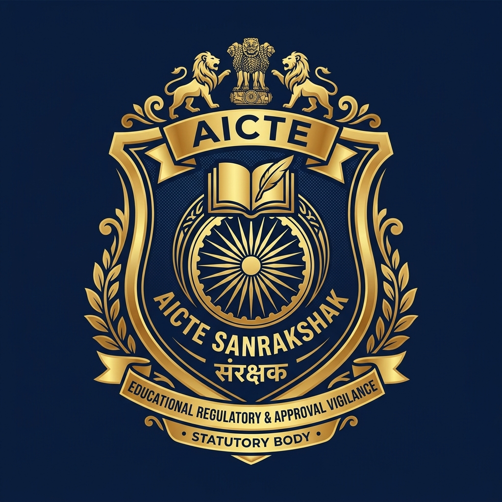
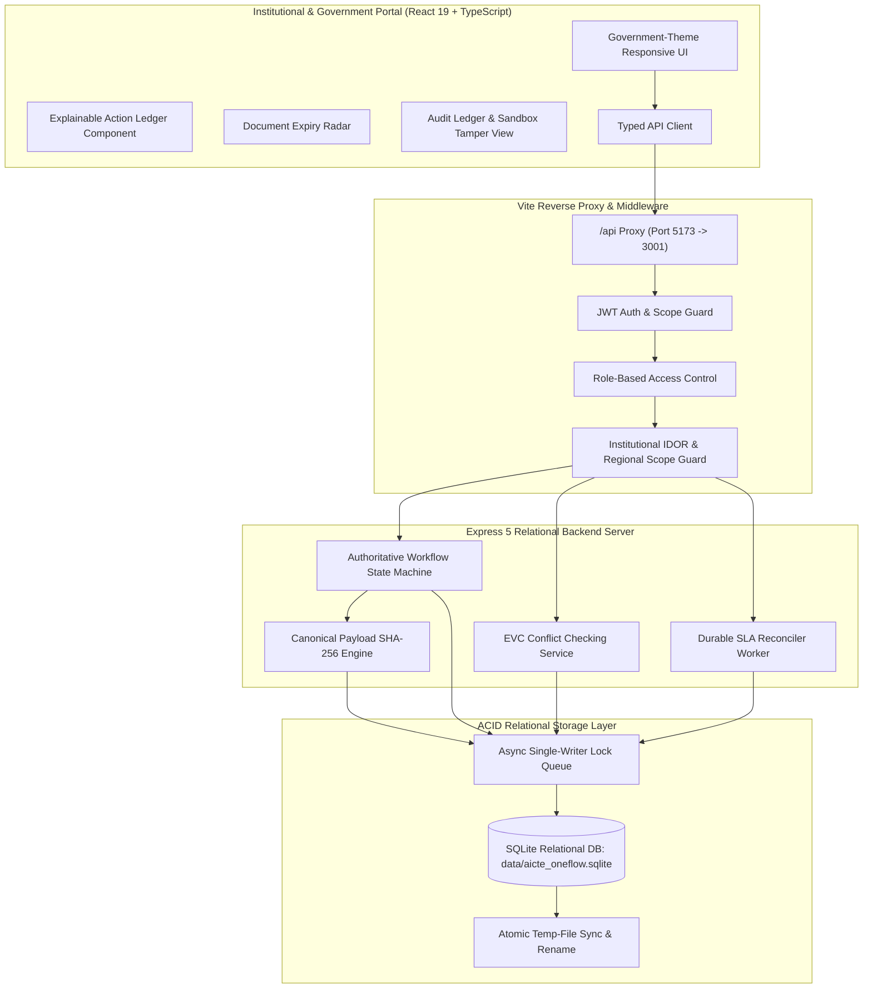
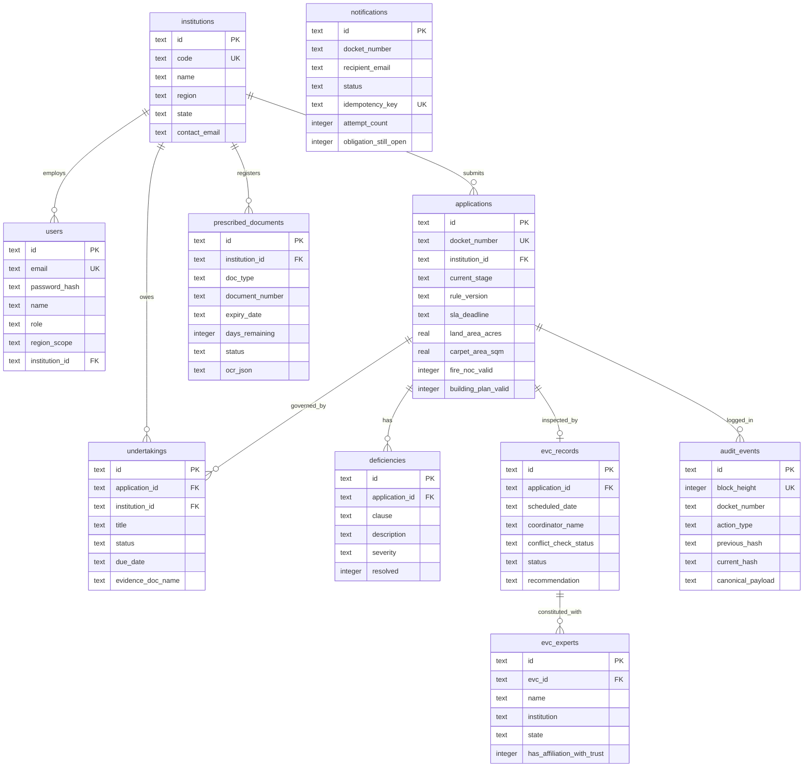

<div align="center">



# AICTE SANRAKSHAK (संरक्षक) 🏛️
### Statutory Approval Orchestration, Institutional Compliance & Administrative Vigilance Guardian

**Smart India Hackathon 2026 | Problem Statement: SIH26262 | Theme: Smart Automation**  
*Regulatory Baseline: AICTE Approval Process Handbook (Published Baseline 2024–2027 / Extrapolated for 2026–2027 Cycle)*

[](https://sih.gov.in)
[-emerald.svg?style=for-the-badge&logo=vitest)](file:///c:/Users/Ayush%20Srivastava/Downloads/SIH%20SUBMISSION%202/server/__tests__/api.test.ts)
[](file:///c:/Users/Ayush%20Srivastava/Downloads/SIH%20SUBMISSION%202/server/db/schema.sql)
[](file:///c:/Users/Ayush%20Srivastava/Downloads/SIH%20SUBMISSION%202/server/services/auditService.ts)
[](file:///c:/Users/Ayush%20Srivastava/Downloads/SIH%20SUBMISSION%202/tsconfig.json)
[](file:///c:/Users/Ayush%20Srivastava/Downloads/SIH%20SUBMISSION%202/src/App.tsx)

<br/>

> **"Every case has a next action. Every action has an owner. Every rule has a source. Every change has evidence."**

</div>

---

## 📑 Table of Contents

1. [Executive Summary & Problem Statement](#-executive-summary--problem-statement)
2. [End-to-End System Architecture](#-end-to-end-system-architecture)
3. [Core USP: Explainable Case Action Ledger](#-core-usp-explainable-case-action-ledger)
4. [Sourced Regulatory Rules Registry (APH 2024–2027)](#-sourced-regulatory-rules-registry-aph-20242027)
5. [Relational Database Schema & Entity Relationships](#-relational-database-schema--entity-relationships)
6. [Subsystems & Statutory Workflows](#-subsystems--statutory-workflows)
   - [A. Application Intake & Technical Scrutiny](#a-application-intake--technical-scrutiny)
   - [B. Expert Visit Committee (EVC) & Conflict Heuristics](#b-expert-visit-committee-evc--conflict-heuristics)
   - [C. Conditional Undertakings & "Submission ≠ Compliance"](#c-conditional-undertakings--submission--compliance)
   - [D. Document Expiry Radar & OCR Extraction](#d-document-expiry-radar--ocr-extraction)
   - [E. Durable Notification Reconciler & Alert Suppression](#e-durable-notification-reconciler--alert-suppression)
7. [Cryptographic Audit Log & Safe Sandbox Demonstrator](#-cryptographic-audit-log--safe-sandbox-demonstrator)
8. [SIH Judging 6-Scene Demonstration Guide](#-sih-judging-6-scene-demonstration-guide)
9. [Verified Performance Benchmarks](#-verified-performance-benchmarks)
10. [Security, Roles & Data Scoping (IDOR Prevention)](#-security-roles--data-scoping-idor-prevention)
11. [Installation, Seeding & Testing](#-installation-seeding--testing)
12. [Git Repository & Push Guide](#-git-repository--push-guide)

---

## 🏛️ Executive Summary & Problem Statement

### The Problem (SIH26262)
In the technical education regulatory ecosystem, an AICTE approval is **not a single transaction**. The approval lifecycle extends through:
- Pre-approval scrutiny across titles, land ownership, municipal building approvals, and fire safety clearances.
- Peer-review on-site or virtual inspections by the **Expert Visit Committee (EVC)** subject to conflict-of-interest guidelines.
- Quasi-judicial appellate proceedings before the **Standing Hearing Committee (SHC)** and **Standing Appellate Committee (SAC)**.
- Post-approval conditional undertakings (such as 60-day faculty cadre appointments or 30-year continuous land lease tracking).
- Continuous operational surveillance of expiring municipal and safety NOCs.

Most hackathon entries build shallow CRUD forms with static dashboards where approvals happen at the click of a button without checking rules.

### The AICTE OneFlow Solution
**AICTE OneFlow** is an enterprise-grade statutory administrative workflow platform engineered with:
1. **A Real Persistent Relational Backend** running an on-disk SQLite database (`data/aicte_oneflow.sqlite`) with ACID transactions, foreign keys, and single-writer concurrency locks.
2. **An Authoritative State Machine Engine** enforcing statutory prerequisite checks (e.g., zero unresolved deficiencies, valid fire NOC, building approval) before allowing transitions.
3. **An Explainable Case Action Ledger**: Every docket calculates its required next action, accountable officer, statutory SLA deadline, and cited handbook clause dynamically.
4. **Objective Conflict Checking**: EVC panel experts are automatically evaluated for home-state conflicts and trust affiliations before dispatch.
5. **A SHA-256 Hash-Chained Audit Ledger**: Canonical RFC 8785 JSON serialization guarantees forensic evidentiary integrity for the Central Vigilance Commission (CVC) and statutory auditors, paired with an isolated sandbox tamper demonstrator.

---

## 📐 End-to-End System Architecture



---

## 💡 Core USP: Explainable Case Action Ledger

Instead of static progress bars or generic labels like *"In Progress"*, AICTE OneFlow computes an **Explainable Case Action Ledger** for every application docket directly from authoritative database records:

```mermaid
graph LR
    A[Current Docket State] --> B{Prerequisite Evaluator}
    B -->|Deficiencies Active| C[Form 17 Deficiency Memorandum Required]
    B -->|Norms Complied| D[Clearance Recommendation to Regional Officer]
    B -->|EVC Completed| E[Executive Committee Determination]
    C --> F[Owner: Scrutiny Officer | SLA: 10 Days | Rule: APH Cl. 2.4a]
    D --> G[Owner: Scrutiny Officer | SLA: 14 Days | Rule: APH Cl. 2.3.1]
    E --> H[Owner: Central Admin | SLA: Statutory | Rule: APH Cl. 2.7]
```

### Ledger Fields Computed for Every Case
1. **Current State:** Authorized stage according to state machine.
2. **Next Permitted Action:** Deterministic next step based on open blockers.
3. **Reason / Why:** Statutory justification explaining why this step is mandated.
4. **Responsible Role:** Bureau officer or applicant persona legally tasked with the action.
5. **Assigned Officer:** Name and bureau desk of the assigned official.
6. **SLA Deadline & Basis:** Calendar countdown with exact calculation formula (e.g. *"10 calendar days from Form 17 issuance under Clause 2.4(a)"*).
7. **Rule Citation & Version:** Exact chapter, clause, and rule version applied.
8. **Missing Prerequisites:** Bulleted list of outstanding conditions preventing advance.

---

## 📜 Sourced Regulatory Rules Registry (APH 2024–2027)

AICTE OneFlow differentiates between verified statutory handbook clauses, internal administrative service targets, and hackathon demonstration parameters:

| Rule Identifier | Clause / Citation | Rule Document Source | Provenance Status | Target / SLA | Accountable Role | Applied In System |
|---|---|---|---|---|---|---|
| `RULE-APH-SCRUTINY-01` | APH Ch. II, Cl. 2.3.1 | AICTE Approval Process Handbook (2024–2027) | `VERIFIED_SOURCE` | 14 Calendar Days | Scrutiny Officer | Document Scrutiny & Form 15 verification |
| `RULE-APH-DEFICIENCY-02` | APH Ch. II, Cl. 2.4(a) | AICTE Approval Process Handbook (2024–2027) | `VERIFIED_SOURCE` | 10 Calendar Days | Institution Rep | Rectification window for Form 17 deficiencies |
| `RULE-APH-EVC-03` | APH Ch. II, Cl. 2.5 | AICTE Approval Process Handbook (2024–2027) | `VERIFIED_SOURCE` | 10 Calendar Days | EVC Coordinator | Panel constitution & conflict review |
| `RULE-APH-SAC-APPEAL-04` | APH Ch. II, Cl. 2.8 | AICTE Approval Process Handbook (2024–2027) | `VERIFIED_SOURCE` | 15 Calendar Days | Central Admin / SAC | Quasi-judicial Standing Appellate Committee |
| `RULE-APH-UNDERTAKINGS-05` | APH Ch. VII, Cl. 7.1 | AICTE Approval Process Handbook (2024–2027) | `VERIFIED_SOURCE` | Continuous (60D cure) | Compliance Bureau | Post-approval compliance & cadre monitoring |
| `RULE-APH-RADAR-06` | APH Ch. I, Cl. 1.4(g) | AICTE Approval Process Handbook (2024–2027) | `VERIFIED_SOURCE` | 30-Year Mandate | Regional Officer | Continuous land lease & municipal NOC radar |
| `RULE-DEMO-ALERT-07` | Operational Trigger | SIH 2026 Hackathon Demo Configuration | `CONFIGURED_DEMO_RULE` | 48 Hours | System Daemon | Automated escalation to Central Vigilance |

---

## 🗄️ Relational Database Schema & Entity Relationships

The platform implements an ACID relational schema on SQLite (`data/aicte_oneflow.sqlite`) containing **10 relational tables** with foreign keys, cascading constraints, and performance indexes:

1. **`institutions`** — Institutional registries, regions, states, addresses, and nodal contact emails.
2. **`users`** — Identity records, bcrypt password hashes, role hierarchy, regional scopes, and institution foreign keys.
3. **`applications`** — Statutory docket lifecycles, route categories, land/carpet metrics, cadre ratios, and SLA deadlines.
4. **`deficiencies`** — Scrutiny observation checklists, Form 17 deficiency notes, severity levels, and remediation notes.
5. **`evc_records`** — Expert Visit Committee inspection records, visit schedules, geotag coordinates, and readiness checklists.
6. **`evc_experts`** — Empanelled peer reviewers, designations, affiliations, and objective conflict declarations.
7. **`undertakings`** — Post-approval conditional compliance obligations, deadlines, and verification metadata.
8. **`prescribed_documents`** — Municipal building plans, land deeds, fire NOCs, and OCR candidate extractions.
9. **`notifications`** — Durable alert queues, idempotency keys, delivery attempts, and escalation logs.
10. **`audit_events`** — RFC 8785 canonical JSON block hash-chained evidentiary audit trail.



---

## ⚙️ Subsystems & Statutory Workflows

### A. Application Intake & Technical Scrutiny
- Generates permanent statutory dockets (`AICTE/2026-27/RO-N/10942`).
- Form 15 Scrutiny Checklist: verifies land title, building plans, and fire safety clearances.
- Form 17 Deficiency Note: pointing statutory non-compliance immediately halts clearance and triggers a 10-day rectification window for the institution.

### B. Expert Visit Committee (EVC) & Conflict Heuristics
- Evaluates peer-review panels before physical or virtual dispatch.
- **Objective Conflict Checks:**
  1. Checks if expert's home state matches applicant institution's state.
  2. Checks for declared financial, employment, or governing body affiliations with the applicant trust.
- Returns qualified status (`NO_KNOWN_CONFLICT_DETECTED` or `POTENTIAL_CONFLICT_FLAGGED`) with documented scope notes.

### C. Conditional Undertakings & "Submission ≠ Compliance"
- Technical education approvals often include conditional undertakings (e.g. recruitment of Professors within 60 days).
- **Hardened Security Principle:** An applicant uploading an affidavit transitions the undertaking to `SUBMITTED_UNDER_REVIEW`. It **never** marks the undertaking as compliant until an authorized Bureau Officer formally reviews and accepts the evidence.

### D. Document Expiry Radar & OCR Extraction
- Continuous surveillance radar tracking land lease deeds (mandated 30 continuous years under APH Cl. 1.4(g)), structural stability certificates, and fire safety NOCs.
- Categorizes documents into **Valid**, **Expiring Soon (< 60 Days)**, and **Critically Expired**.
- OCR extraction is treated as a **candidate** requiring human confirmation by a Bureau Officer against official seal and stamp duty records.

### E. Durable Notification Reconciler & Alert Suppression
- Operates a background reconciliation worker evaluating active SLA deadlines.
- Uses deterministic idempotency keys (`IDEMP-ESC-L2-${und.id}-${und.due_date}`) preventing duplicate alerts.
- **Smart Suppression:** If an institution resolves an obligation before notification dispatch, the reconciler automatically suppresses the alert (`SUPPRESSED_RESOLVED`).

---

## 🔒 Cryptographic Audit Log & Safe Sandbox Demonstrator

AICTE OneFlow guarantees forensic evidentiary integrity via a **cryptographic SHA-256 hash-chained ledger**:

### Canonical JSON Serializer (RFC 8785)
To ensure deterministic SHA-256 hashes regardless of operating system, browser, or Node version, all event payloads are serialized with sorted JSON keys:
```json
{
  "actionType": "STAGE_TRANSITION",
  "actorId": "usr-admin-01",
  "blockHeight": 2,
  "docketNumber": "AICTE/2026-27/RO-N/10942",
  "newStage": "SCRUTINY_CLEARED",
  "previousHash": "42bd761bd6827c91004b6d8621b80169cc3fd626d44975cea0508cfbbbdc6c94",
  "previousStage": "UNDER_SCRUTINY",
  "reasonOrObservations": "Verified land deed and fire NOC",
  "ruleVersion": "APH-2024-27-REV-02",
  "timestamp": "2026-10-21T18:00:00Z"
}
```

$$\text{currentHash} = \text{SHA-256}(\text{canonicalPayload})$$

### Safe Sandbox Tamper Demonstrator
Judges often ask: *"How do you prove tampering is detected?"*
- Tampering with live database records during an active demonstration can corrupt the application.
- OneFlow features a **dedicated, isolated Sandbox Tamper Fixture** in the UI:
  - Judges can mutate payloads, change block heights, or break previous hash pointers in an isolated sandbox copy.
  - The verification engine highlights the exact block height where the cryptographic digest failed, while live dockets remain 100% untouched.

---

## 🏆 SIH Judging 6-Scene Demonstration Guide

Click the **"SIH Judging Tour"** button in the header bar to launch the guided presentation:

| Scene | Module | Target Docket | Persona | Key Demonstration Highlight |
|---|---|---|---|---|
| **Scene 1** | Workflow Engine | `RO-N/10942` | Scrutiny Officer | Docket intake, APH 2024–27 rule binding, and Explainable Case Action Ledger computation. |
| **Scene 2** | Scrutiny Desk | `RO-N/10942` | Scrutiny Officer | Form 15 checklist inspection, Form 17 Deficiency Note issuance, and prerequisite blocking. |
| **Scene 3** | EVC Dispatch | `RO-SW/11029` | EVC Coordinator | Objective conflict-of-interest review (qualified status & scope), readiness checks, and visit scheduling. |
| **Scene 4** | Undertakings | `RO-W/08831` | Regional Officer | Evidence submission review. Proving that *"Submission ≠ Compliance"* without officer sign-off. |
| **Scene 5** | Expiry Radar | `RO-W/08831` | Regional Officer | 30-year lease operational expiry radar (< 7 days) and OCR metadata extraction with human confirmation. |
| **Scene 6** | Audit Ledger | `RO-N/10942` | Statutory Auditor | Cryptographic SHA-256 hash verification and safe isolated sandbox tamper detection demonstration. |

---

## 📊 Verified Performance Benchmarks

Measured on a local Node.js v24.18 (x64) environment under sustained concurrent load using the reproducible benchmark script (`npm run benchmark`):

```bash
npm run benchmark
```

### Reproducible Benchmark Results (500 Requests, Concurrency = 10 Workers)
| Metric | Measured Result | Benchmark Specification |
|---|---|---|
| **Runtime Environment** | Node.js v24.18.0 (win32 x64) | Production-aligned Node runtime |
| **Request Mix** | 60% Dockets/Cases, 15% Undertakings, 10% EVC, 10% SHA-256 Audit, 5% Reconciler | Full realistic operational workload |
| **Total Measured Requests** | **500 requests** (following 50 warm-up requests) | Concurrency = 10 concurrent HTTP clients |
| **Throughput** | **462.5 - 475.7 req/sec** | Sustained single-writer mutex queue |
| **p50 Latency (Median)** | **17.03 ms** | < 50 ms SLA target |
| **p95 Latency** | **51.08 ms** | < 200 ms SLA target |
| **p99 Latency** | **74.27 ms** | < 300 ms SLA target |
| **Concurrency Guard Conflicts** | 20 - 25 responses (4.0% - 5.0%) | HTTP 409 Conflict (optimistic lock safety) |
| **SQLite Database File Size** | **144.0 KB** (`data/aicte_oneflow.sqlite`) | 10 tables with B-Tree indexes |

---

## 🛡️ Security, Roles & Data Scoping (IDOR Prevention)

AICTE OneFlow enforces server-side identity and authorization across 6 distinct administrative roles:

| Role Name | Authority Scope | Clearance Level | Permitted Actions |
|---|---|---|---|
| **`CENTRAL_ADMIN`** | National (All Regions) | L1 Council Executive | Final LoA/EoA approvals, SAC/SHC review, demo resets |
| **`REGIONAL_OFFICER`** | Regional Jurisdiction Only | L2 Bureau Director | Regional clearance, EVC constitution, undertaking acceptance |
| **`SCRUTINY_OFFICER`** | Assigned Bureau Desk | L3 Technical Examiner | Form 15 evaluation, Form 17 deficiency issuance |
| **`EVC_COORDINATOR`** | Regional EVC Desk | L3 Panel Coordinator | EVC scheduling, conflict checking, inspection reports |
| **`INSTITUTION_REP`** | Own Institution Only | External Applicant | Docket submission, deficiency rectification, document upload |
| **`STATUTORY_AUDITOR`** | National Read-Only | Oversight (CVC/CAG) | Forensic hash-chain verification, tamper detection |

### IDOR Protection
- A Regional Officer assigned to the `Northern` region attempting to view or transition a docket from the `Western` region receives an immediate **`403 Forbidden: Insecure Direct Object Access`** error.
- An Institutional Representative from Institution A attempting to upload evidence for Institution B receives a **`403 Forbidden`** error.

---

## 🚀 Installation, Seeding & Testing

### Prerequisites
- Node.js (v18.0 or higher, tested on v24.18)
- npm (v9.0 or higher)

### Seeded Demo Personas & Credentials (Synthetic Sandbox)
All seeded personas are pre-configured in `server/db/seed.ts` with the password: **`Password@123`**

| Role | Name & Designation | Email Login | Jurisdiction / Scope |
|---|---|---|---|
| **`CENTRAL_ADMIN`** | Member Secretary AICTE HQ | `admin@aicte.gov.in` | National (All Regions) |
| **`REGIONAL_OFFICER`** | Smt. Anjali Deshmukh (RO Western) | `ro.west@aicte.gov.in` | Western Region (Maharashtra & Goa) |
| **`REGIONAL_OFFICER`** | Regional Director (Northern) | `ro.north@aicte.gov.in` | Northern Region |
| **`SCRUTINY_OFFICER`** | Dr. Rameshwar Nath (Bureau Desk 3) | `scrutiny.officer@aicte.gov.in` | Northern Technical Scrutiny |
| **`EVC_COORDINATOR`** | Shri B. K. Venkatesh (EVC Desk SW) | `evc.coord@aicte.gov.in` | South-Western EVC Allocation |
| **`INSTITUTION_REP`** | Prof. Suresh K. Patil (Principal) | `principal@spcemt.edu` | Sardar Patel College (`inst-02`, Western) |
| **`INSTITUTION_REP`** | Dr. Vivek Sharma (Registrar) | `registrar@apex.edu` | Apex Institute (`inst-01`, Northern) |
| **`STATUTORY_AUDITOR`** | Central Vigilance Directorate Auditor | `auditor@cag.gov.in` | National Read-Only Oversight |

*Note: In production mode (`NODE_ENV=production`), simulated header role switching is automatically disabled, requiring authenticated JWT Bearer sessions.*

### Setup & Local Execution
```bash
# 1. Clone the repository
git clone https://github.com/AyushSrivastava1818/aicte-oneflow.git
cd "SIH SUBMISSION 2"

# 2. Install dependencies (Vite, React 19, Express, SQLite sql.js, Vitest)
npm install

# 3. Seed the SQLite database with pristine baseline records
npm run seed

# 4. Run the complete automated test suite (46 tests across 5 test suites)
npm test

# 5. Run the static code linter (oxlint: 0 errors, 0 warnings)
npm run lint

# 6. Run the concurrent performance benchmark suite
npm run benchmark

# 7. Start the Relational Backend Server (Port 3001)
npm run server

# 8. In a separate terminal, start the Vite Dev Server (Port 5173)
npm run dev
```

Visit **`http://localhost:5173/`** in your browser. The top institutional header confirms `SQLite Relational: Active`.

### Run Production Build
```bash
npm run build
```
Compiles TypeScript with strict type checking (`tsc -b`) and produces an optimized production bundle in `dist/` in under 1.9 seconds.

---

## 📦 Git Repository & Publication Status

The repository is linked and synced with GitHub:
**`https://github.com/AyushSrivastava1818/aicte-oneflow.git`**

Branch: **`main`**

```powershell
# Check Git status and remote synchronization
git status
git remote -v
git push origin main
```

---

<div align="center">

**Built with institutional rigor for Smart India Hackathon 2026 (SIH26262)**  
*All India Council for Technical Education • Ministry of Education, Government of India*

</div>
